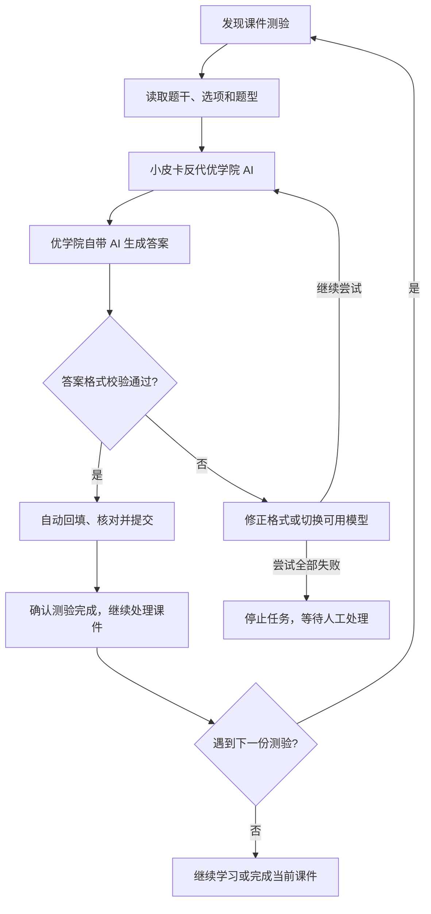

<!-- github-readme-header:start -->
<p align="center">
  
</p>
<p align="center">
  <a href="https://www.python.org/"></a>
  <a href="https://www.microsoft.com/windows/"></a>
  <a href="https://github.com/23swccp/dgut-bot/releases"></a>
  <a href="https://github.com/23swccp/dgut-bot"></a>
</p>
<h1 align="center">dgut-bot</h1>
<p align="center">莞工小皮卡</p>
<!-- github-readme-header:end -->

**莞工小皮卡**，东莞理工学院优学院小工具。支持课件学习、AI 答题、作业查看和课件导出，仅支持 Windows。

> **悲报：签到功能已于 2026 年 10 月 23 日停用。**

## 下载

**[下载 Windows 安装包](https://github.com/23swccp/dgut-bot/releases/latest/download/DgutBot-win-Setup-Qing-Zhi-Xia-Zai-Zhe-Ge.exe)** · [查看版本说明](https://github.com/23swccp/dgut-bot/releases/latest)

下载 `DgutBot-win-Setup-Qing-Zhi-Xia-Zai-Zhe-Ge.exe`，安装后打开即可。发布页里的其余附件供程序自动更新使用。

程序内可在“设置 → 软件更新”检查新版。旧版无法更新时，也可以重新下载安装包覆盖升级。

## 开始使用

1. 打开小皮卡，程序会自动寻找浏览器。推荐使用 Chrome 或 Microsoft Edge；找不到时，按提示选择浏览器程序。
2. **在小皮卡打开的浏览器里登录优学院**，后续操作也使用这个浏览器。
3. 回到小皮卡，选择需要的功能。刷课可直接点击扫描出的课件，导出则先勾选课程。

登录会缓存 24 小时，下次打开会先尝试恢复；学校登录状态提前失效时，重新登录即可。

## 能做什么

### 课件学习

进入“刷课”后，程序会列出未完成课件。可以搜索课程或章节，点击一项开始学习；目前一次处理一个课件。支持视频倍速、文档和 PPT 翻阅、章节切换及常见提示弹窗。

如果自动打开失败，在程序浏览器里手动进入课程，打开地址包含 `ua.dgut.edu.cn/learnCourse` 的课件页：


然后回到刷课模块，按 `Enter` 或输入 `start`。输入 `stop` 或 `/` 停止，`speed 8` 调整为 8 倍速，`open` 打开课件网站，`clear` 清空记录。

### AI 答题

**2026.10.25,小皮卡成功实现ai答题loop**

**反代优学院自己的 AI，让平台自带的 AI 来完成课件答题。** 支持单选、多选、判断和填空，从识题、生成答案到回填提交，整套流程自动完成。在当前课件内，答完一页继续学习，遇到下一份测验再次接手。



支持**多模型自动切换**：在 AI 工作台指定首选模型，遇到额度耗尽或服务异常时，自动尝试其他可用模型，无需手动逐个重试。

自动答题默认开启，可在“设置 → 刷课”关闭或调整题型。设置会自动保存，重启后保留；修改后需要重新启动刷课任务，当前任务仍按启动时的设置运行。

AI 可能答错，图片和公式暂不支持。答题失败或遇到不支持的题型时，任务会停止，留在页面等待人工处理。

### 作业

在“作业列表”中按课程查看待处理作业、截止时间和批阅状态，打开作业页面或查看互评任务。不想再看到的课程和作业可以归档，也可以随时恢复。切换到“写作业”可向已识别的作业输入框发送内容，也可使用字迹生成器实时预览手写风格文字，选择字体、纸张（含真实纸张照片）和断水程度，分页下载 PNG/JPG 图片；切换期间保留当前草稿。

### 课件导出

勾选课程，选择需要的范围和文件类型，点击“读取目录并选择”，再导出所选内容。支持课程资源、课件、作业与互评材料，也可以只导出文档、图片或音视频。

文件保存在 `courseware/<课程名>/`，附带 Markdown 和 HTML 索引，完成后自动打开文件夹。测验题目不导出；部分视频导出需要安装 FFmpeg，失败详情可在页面查看。

界面截图使用真实组件和合成数据：[课程选择](docs/courseware-export/selection.jpg)、[导出进度](docs/courseware-export/progress.jpg)。

## 常见问题

**为什么开启答题后还是跳过了？**

先确认当前任务启动前已开启自动答题。运行中修改设置，需要停止后重新开始。出错时查看“运行日志”里的具体原因。

**课程或作业列表没有更新？**

扫描结果会缓存约五分钟，点击重新扫描可以立即刷新。

**怎么下载不了安装包，或者更新失败？**

安装包和更新都从 GitHub 下载。请检查网络和系统代理，必要时使用能访问 GitHub 的网络加速器。

**出问题去哪里找日志？**

侧边栏的“运行日志”可以查看并导出完整记录。本机也会保存 `data.md`，保存位置可在设置中修改。

## 反馈与许可

遇到问题或有想法，欢迎[提交 Issue](https://github.com/23swccp/dgut-bot/issues)，也可以私信贴吧用户 **785434816**。反馈时带上程序版本、操作步骤和错误提示，方便定位。

个人项目，与学校及优学院没有官方关联。请遵守学校规定、课程要求和平台规则。

[MIT License](https://github.com/23swccp/dgut-bot/blob/main/LICENSE) · [GitHub 项目主页](https://github.com/23swccp/dgut-bot)

## 开发环境与本地运行

后端使用 Python，前端使用 React、TypeScript 和 Vite。源码运行需要 Python 3.11+ 和 Node.js 20+。

```powershell
git clone https://github.com/23swccp/dgut-bot.git
cd dgut-bot
python -m pip install -r requirements.txt
npm ci --prefix frontend
.\start.bat
```

如果您想要参与贡献:接口、代码约定和测试方式见[开发文档](./开发文档.md)。
